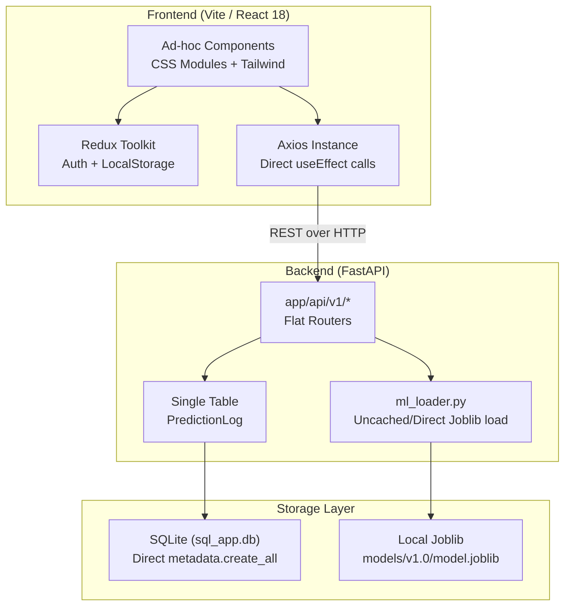
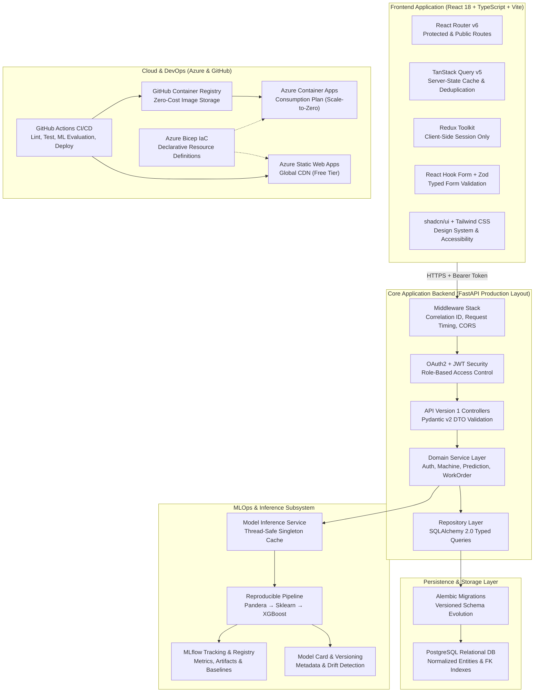
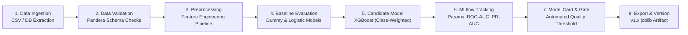
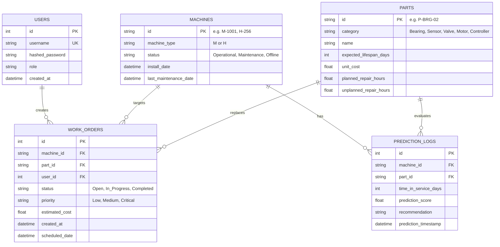
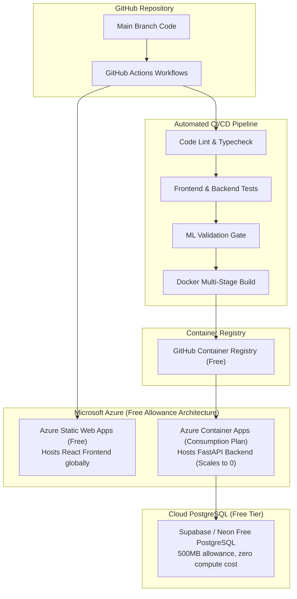

# System Architecture: Current vs. Target Production

**Project Name**: Predictive Part Failure Dashboard (PPFD)  
**Document Version**: 2.0  
**Status**: Approved Architecture Blueprint  

---

## 1. Architectural Evolution Overview

The PPFD system transitions from a prototype/POC architecture to an **interview-grade, production-style, cloud-ready architecture**.

### 1.1 Current Architecture (Prototype State)



### 1.2 Target Production Architecture



---

## 2. Layer-by-Layer Architectural Breakdown

### 2.1 Frontend Architecture

#### Core Tech Stack
- **Framework**: React 18 + TypeScript + Vite.
- **Server State**: **TanStack Query (React Query) v5** for all API data fetching, caching, query invalidation, and optimistic mutations. Eliminates boilerplate `useEffect` and race conditions.
- **Client State**: **Redux Toolkit** restricted to purely client-side session state (user identity, JWT token, navigation UI state).
- **Design System & Styling**: **Tailwind CSS + shadcn/ui** primitives (built on Radix UI for accessibility: Dialogs, Badges, Tooltips, Metric Cards, Select, Tables).
- **Form Management**: **React Hook Form** paired with **Zod schemas** for compile-time and runtime validation.
- **Data Visualization**: **Recharts** wrapped in responsive, accessible theme-aware card containers.

#### Directory Layout
```
frontend/src/
├── app/                  # Redux store & root TanStack Query client
├── api/                  # Axios base client, auth interceptors & endpoints
├── components/
│   ├── common/           # ProtectedRoute, PublicRoute, ErrorBoundary
│   ├── layout/           # AppNavbar, Sidebar, PageContainer, Footer
│   └── ui/               # Reusable shadcn/ui primitives (Button, Card, Badge, Table, Input)
├── features/
│   ├── authentication/   # LoginForm, authSlice, useAuth hook, authApi
│   ├── fleet/            # MachineCard, MachineGrid, FleetFilters, useFleetMachines
│   ├── predictions/      # PredictionForm, RiskGauge, HistoryChart, usePredictions
│   ├── reliability/      # ReliabilityChart, PartReliabilityProfile, usePartStats
│   └── maintenance/      # FinancialImpactCard, WorkOrderModal, useWorkOrders
├── hooks/                # Global utility hooks (useDebounce, useMediaQuery)
├── types/                # Strongly typed TypeScript interfaces and Zod schemas
└── pages/                # Route entry views (LoginPage, FleetPage, MachineDetailPage)
```

---

### 2.2 Backend Architecture

#### Core Tech Stack
- **Framework**: **FastAPI** running on Python 3.13 with Uvicorn.
- **ORM & Database**: **SQLAlchemy 2.0 (Declarative)** with **Alembic** migrations.
- **Validation**: **Pydantic v2** (`from_attributes = True`, strict typing).
- **Authentication**: OAuth2 Password Bearer with JWT (`python-jose`), bcrypt password hashing (`passlib`), and role-based route dependencies (`Admin`, `Technician`, `Viewer`).
- **Telemetry**: Request correlation IDs (`X-Correlation-ID`), structured JSON logging (`structlog` or standard logging filter), and latency timing headers (`X-Process-Time`).

#### Directory Layout
```
backend/
├── alembic/              # Database migration environments & script revisions
│   ├── versions/
│   └── env.py
├── app/
│   ├── api/
│   │   ├── deps.py       # Dependency injection (get_db, get_current_user, require_role)
│   │   └── v1/
│   │       ├── auth.py         # Login, token refresh, current user profile
│   │       ├── machines.py     # Fleet CRUD, pagination, filtering, history
│   │       ├── parts.py        # Part catalog & reliability distributions
│   │       ├── predictions.py  # Model inference endpoint & prediction audit log
│   │       ├── simulation.py   # Daily fleet wear-and-tear simulation
│   │       └── work_orders.py  # Maintenance work order creation & tracking
│   ├── core/
│   │   ├── config.py     # Pydantic BaseSettings loading .env
│   │   ├── security.py   # Password hashing & JWT generation/validation
│   │   ├── logging.py    # Structured JSON log formatting
│   │   └── middleware.py # Request correlation & process timing
│   ├── db/
│   │   ├── database.py   # Engine, connection pooling, session generator
│   │   └── base.py       # Base model imports for Alembic auto-discovery
│   ├── models/           # SQLAlchemy Declarative Models
│   │   ├── user.py
│   │   ├── machine.py
│   │   ├── part.py
│   │   ├── prediction_log.py
│   │   └── work_order.py
│   ├── repositories/     # Data access abstraction
│   │   ├── machine_repo.py
│   │   └── prediction_repo.py
│   ├── schemas/          # Pydantic v2 DTOs (Request / Response)
│   │   ├── machine.py
│   │   ├── part.py
│   │   ├── prediction.py
│   │   ├── user.py
│   │   └── work_order.py
│   ├── services/         # Domain Business Logic
│   │   ├── auth_service.py
│   │   ├── ml_service.py # Inference & caching layer
│   │   └── simulation_service.py
│   └── main.py           # Application factory, middleware & health routes
├── tests/                # Pytest automated test suite
├── seed_db.py            # Reproducible database seeder
└── requirements.txt
```

---

### 2.3 Machine Learning Architecture & MLOps Pipeline

#### Pipeline Stages


1. **Data Validation (Pandera)**: Validates input columns, non-null constraints, and numeric ranges (`time_in_service_days >= 0`, `part_failed in [0, 1]`) before any training step runs.
2. **Feature Engineering**:
   - `machine_type`: Extracted prefix (`M` or `H`).
   - `service_type`: Retained with aligned categorical levels.
   - Categorical Encoding: Scikit-learn `OneHotEncoder(handle_unknown='ignore')`.
3. **Model Selection & Baselines**:
   - Baseline 1: `DummyClassifier(strategy='stratified')`.
   - Baseline 2: `LogisticRegression(class_weight='balanced')`.
   - Production Model: `XGBClassifier(scale_pos_weight=5, eval_metric='logloss')`.
   - Evaluation Metrics: **PR-AUC**, **ROC-AUC**, **Precision**, **Recall on Class 1 (Failures)**. Accuracy is explicitly deprioritized due to class imbalance.
4. **Experiment Tracking**: Integrated with **MLflow** for local tracking of experiments, metrics, run tags, and model versions.
5. **Inference Guarding**:
   - The inference service in `backend/app/services/ml_service.py` loads the fitted bundle (`model`, `encoder`, `feature_columns`) into memory once.
   - Inference aligns feature vectors against `feature_columns` to ensure zero training-serving skew.

---

### 2.4 Relational Database Architecture



---

### 2.5 Cloud & DevOps Architecture (Azure Zero-Cost Target)



#### Cost Mitigation Strategy:
- **Frontend**: Hosted on **Azure Static Web Apps (Free Plan)**: \$0/month.
- **Backend API**: Hosted on **Azure Container Apps (Consumption)** with `minReplicas = 0`. First 180,000 vCPU-seconds and 360,000 GiB-seconds are free each month: \$0/month for normal testing/interview traffic.
- **Database**: Free-tier cloud PostgreSQL instance (Supabase or Neon): \$0/month.
- **Container Registry**: **GitHub Container Registry (ghcr.io)**: Unlimited public containers, avoids Azure ACR fees (\$5/month saved).
- **IaC**: 100% defined in **Azure Bicep** (`infra/main.bicep`) with automated teardown scripts (`infra/teardown.sh`).
